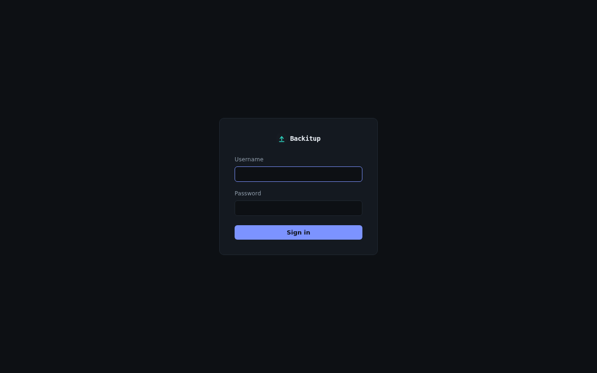

# Back! It! Up!

Self-hosted, centralized **fleet backup** for Linux + macOS. A clean control plane
on top of proven tools (rsync, OpenSSH, rclone): one server, one webgui, many dumb
cron-triggered clients, with hot backups on the server and optional rclone offsite
tiering to a Backblaze B2 bucket. Encryption is available when the offsite destination
is an rclone `crypt` remote you configure.

Add a machine by issuing a key in the webgui, paste one cron line on the host, and
watch the whole fleet's backup health from a single dashboard.

---

## Screenshots

| Dashboard | Add a client |
|-----------|-------------|
|  |  |

| Client created — one-time secrets | Client detail |
|----------------------------------|---------------|
|  |  |

| Login | Empty dashboard |
|-------|----------------|
|  |  |

---

## Table of contents

- [Why](#why)
- [How it works](#how-it-works)
- [Architecture](#architecture)
- [Quick start (Docker Compose)](#quick-start-docker-compose)
- [Building the images](#building-the-images)
- [Running the server with `docker run`](#running-the-server-with-docker-run)
- [Client setup (per host)](#client-setup-per-host)
- [Configuration reference](#configuration-reference)
- [Backup modes](#backup-modes)
- [Retention & offsite](#retention--offsite)
- [Restore](#restore)
- [Security model](#security-model)
- [Development](#development)
- [Project layout](#project-layout)

---

## Why

restic / Borg / Kopia are excellent backup *engines* with no clean centralized fleet
control. UrBackup has fleet control but a clunky UI and a heavy client. Back! It! Up!
is the clean **control plane**: the server owns all configuration, the client is a dumb
uploader you drop on any host, and one dashboard answers the only question that
matters — *are my backups OK?*

Back! It! Up! deliberately does **not** reinvent the data engine. Transfer is rsync +
OpenSSH, offsite + encryption is rclone, storage is plain files you can browse. The
code we write is the control plane, because that is where the value is.

## How it works

- **The server owns WHAT** — backup mode, excludes, retention, offsite target, keys.
- **The host's cron owns WHEN** — the client is fire-and-forget; you set the schedule
  by editing the host crontab. Changing frequency means editing cron, not the webgui.
- **The client is a dumb, stateless uploader** — triggered by cron, it runs once and
  exits. It reads the source **read-only** and never modifies the host.
- **Each client** has a server-issued SSH key (data channel) + bearer token (control
  channel) and its own confined directory on the server.
- **Hot backups** live on the server; separate workers handle optional offsite uploads
  and maintenance, with independent hot/cold retention horizons.

## Architecture

```
        host cron (owns WHEN)
            │ docker run --rm   (source bind-mounted READ-ONLY)
            ▼
   ┌─────────────────┐   SSH (rsync / sftp, per-client key)   ┌──────────────────┐
   │  client (Go)    │ ─────────────────────────────────────▶ │  sshd container  │
   │  dumb uploader  │                                         │  per-client      │
   │                 │ ◀── HTTPS: GET config / POST status ──▶ │  confined dir    │
   └─────────────────┘            (bearer token)               └──────────────────┘
                                                                        │ shared volumes
                                              ┌──────────────────────────▼──────────────┐
                                              │  app container (Go)                      │
                                              │  HTTP API + webgui + lifecycle timer     │
                                              │  SQLite · admin login · authorized_keys  │
                                              │  lifecycle: offsite (rclone+crypt) FIRST,│
                                              │             then prune; integrity verify │
                                              └──────────────────────────────────────────┘
```

Two server containers (design decision: one app process + one sshd). The app is a
single Go binary (API + webgui + lifecycle timer); SQLite is single-writer so one
process avoids cross-process lock coordination.

## Quick start (Docker Compose)

Requirements: Docker + the Compose plugin.

Save this as `docker-compose.yml` (or clone the repo and use the one included):

```yaml
services:
  app:
    image: th0rn0/backitup-server:latest
    restart: unless-stopped
    environment:
      BACKITUP_ADMIN_USER: admin
      BACKITUP_ADMIN_PASSWORD: changeme          # required — set before first start
      BACKITUP_PUBLIC_HOST: your-server:2222     # sshd host:port (BACKITUP_SERVER in docker run)
      BACKITUP_PUBLIC_API: http://your-server:8080  # control-channel URL (BACKITUP_API in docker run)
      BACKITUP_AUTHKEYS: /srv/authkeys/authorized_keys
      BACKITUP_BACKUP_DIR: /srv/backups
      BACKITUP_SSH_HOST_KEY: /srv/hostkeys/ssh_host_ed25519_key.pub
      # BACKITUP_TLS_CERT: /certs/cert.pem      # uncomment for HTTPS
      # BACKITUP_TLS_KEY:  /certs/key.pem
      # BACKITUP_RCLONE_CONFIG: /data/rclone.conf  # needed for offsite tiering
    ports:
      - "127.0.0.1:8080:8080"   # put behind a TLS reverse proxy in production
    volumes:
      - app-data:/data
      - backups:/srv/backups
      - authkeys:/srv/authkeys
      - sshd-hostkeys:/srv/hostkeys:ro
    healthcheck:
      test: ["CMD", "wget", "-qO-", "http://127.0.0.1:8080/healthz"]
      interval: 30s
      timeout: 3s
      retries: 3

  sshd:
    image: th0rn0/backitup-sshd:latest
    restart: unless-stopped
    environment:
      # Ingest guards: one client cannot fill the shared backup volume. Both are
      # plain byte counts. See "SSH ingest (backitup-sshd)" in the reference.
      BACKITUP_RECV_MAX_BYTES: 53687091200       # 50 GiB per upload
      BACKITUP_RECV_MIN_FREE_BYTES: 2147483648   # never write below 2 GiB free
    ports:
      - "2222:2222"             # data channel — clients SSH into this port
    volumes:
      - backups:/srv/backups
      - authkeys:/srv/authkeys:ro
      - sshd-hostkeys:/srv/hostkeys

volumes:
  app-data:       # SQLite database + rclone config
  backups:        # hot backup store (per-client confined dirs)
  authkeys:       # authorized_keys file shared between app and sshd
  sshd-hostkeys:  # sshd host key; app reads the .pub for known_hosts generation
```

Then:

```sh
docker compose up -d
curl http://127.0.0.1:8080/healthz   # -> ok
```

Open `http://127.0.0.1:8080` and sign in with the admin credentials you set above.
Put a TLS reverse proxy in front before exposing it — the login and client tokens must not cross plaintext.

```sh
docker compose down          # stop
docker compose down -v       # stop and DELETE all volumes (destroys backups!)
```

### Named volumes vs bind mounts

The example above uses **Docker named volumes** (`app-data:`, `backups:`, etc.). Named volumes are managed by Docker: it creates them with the right ownership automatically based on the image's built-in `chown`. This is the easiest setup and requires no extra steps.

If you prefer **bind mounts** (host paths) so you control exactly where data lives on disk, you must pre-create the directories and set ownership to uid **10001** — the user both containers run as — before starting the stack. Docker creates missing host directories as root, and the app will silently fail to write `authorized_keys` (leaving SSH connections broken) or fail to open its database.

```sh
# Adjust the base path to wherever you want data to live.
mkdir -p /servdata/backitup/{app-data,backups,authkeys,sshd-hostkeys}
chown -R 10001:10001 /servdata/backitup/app-data \
                     /servdata/backitup/backups \
                     /servdata/backitup/authkeys \
                     /servdata/backitup/sshd-hostkeys
```

Then use host paths in your compose file instead of named volumes:

```yaml
    volumes:
      - /servdata/backitup/app-data:/data
      - /servdata/backitup/backups:/srv/backups
      - /servdata/backitup/authkeys:/srv/authkeys
      - /servdata/backitup/sshd-hostkeys:/srv/hostkeys:ro
```

#### Directory permissions

Both containers run as uid **10001** (`backitup`). Set ownership and permissions before starting the stack:

```sh
chown -R 10001:10001 /servdata/backitup/{app-data,backups,authkeys,sshd-hostkeys}
chmod 755 /servdata/backitup/app-data
chmod 755 /servdata/backitup/backups
chmod 755 /servdata/backitup/authkeys
chmod 700 /servdata/backitup/sshd-hostkeys   # contains the private SSH host key
```

| Directory       | Mode  | Why                                                              |
|-----------------|-------|------------------------------------------------------------------|
| `app-data`      | `755` | SQLite database — only the app writes it                         |
| `backups`       | `755` | Both containers write here; `755` lets you browse from the host  |
| `authkeys`      | `755` | App writes, sshd reads (`:ro`); contains only public keys        |
| `sshd-hostkeys` | `700` | Contains the private SSH host key — no other process needs it    |

> **Symptom if you forget:** the app starts fine and you can create clients, but
> `/srv/authkeys/authorized_keys` is never written, so the sshd container has no
> authorized keys and every client SSH connection fails with
> `no supported methods remain`. Fix: run the `chown` above, then restart the stack
> or rotate any existing client's credentials to trigger a rewrite.

#### Reading backups without root (the `10001` group)

Both containers run as uid/gid **10001**, so every backup file belongs to
`10001:10001`. The app creates each client's two store directories — `backups/<slug>`
and, for `rsync`, `backups/<slug>/snapshots` — at **`0750`** (owner `rwx`, group `r-x`),
and reconciles them at startup if an older build left them `0700`. An account in gid
**10001** on the host can therefore read the store directly:

```sh
sudo groupadd -g 10001 backitup 2>/dev/null || true   # same number as inside the container
sudo usermod -aG backitup "$USER"                     # log out and back in for it to take effect
ls /servdata/backitup/backups/laptop-docs/snapshots/  # no sudo
```

Three properties of that, all deliberate:

- **The group is the control.** Anyone in gid 10001 on the backup host can read *every*
  client's backups. There is no per-client permission state in backitup, by design;
  give the group only to accounts that may see all of it.
- **A `0700` directory *inside* a snapshot is still `0700`.** `rsync -a` copies the
  source's modes, so a source tree at `0700` lands at `0700` under the `0750` parent and
  the group cannot enter it. Turn on **Group-readable snapshots** for that client
  ([below](#group-readable-snapshots-fidelity-traded-for-operator-access)).
- **A named volume cannot be read this way at all.** Named volumes live under
  `/var/lib/docker`, which is root-only (`0700`) regardless of the modes inside it, so
  no `chmod` in a container or on a volume subdirectory helps. Use a host bind mount
  (`/servdata/backitup/backups:/srv/backups`, as in the compose example above), whose
  ownership you own and can set — or read the store with `sudo` / `docker cp`.

## Building the images

```sh
# Server (control plane): Alpine + rclone, cgo-free.
docker build -t th0rn0/backitup-server:dev -f Dockerfile .

# Client (dumb uploader): Alpine + rsync + openssh-client.
docker build -t th0rn0/backitup-client:dev -f Dockerfile.client .

# SSH ingest (data plane): Debian + OpenSSH + rsync/rrsync.
docker build -t th0rn0/backitup-sshd:dev -f Dockerfile.sshd .
```

The server and client Go binaries are built with `CGO_ENABLED=0`. The sshd image is Debian with OpenSSH and rsync; it does not build a Go binary. The Dockerfiles use multi-platform base images; buildx can target `linux/amd64` and `linux/arm64`:

```sh
docker buildx build --platform linux/amd64,linux/arm64 \
  -t th0rn0/backitup-server:dev -f Dockerfile .
```

## Running the server with `docker run`

```sh
docker run -d --name backitup \
  -p 127.0.0.1:8080:8080 \
  -v backitup-data:/data \
  -v backitup-backups:/srv/backups \
  -e BACKITUP_ADMIN_USER=admin \
  -e BACKITUP_ADMIN_PASSWORD='replace-with-a-strong-password' \
  th0rn0/backitup-server:dev

curl http://127.0.0.1:8080/healthz   # -> ok
```

## Client setup (per host)

The client is **not** a long-running service. The webgui generates the key, token,
and the exact cron line for each client. The shape of that line:

```sh
# Back up /home/me/documents every night at 02:30 (tar.gz mode).
30 2 * * *  docker run --rm \
  --user $(id -u):$(id -g) \
  --mount type=bind,src=/home/me/documents,dst=/source,readonly \
  -v /etc/backitup/laptop-docs:/secrets:ro \
  -e BACKITUP_API=https://backup.example.com:8080 \
  -e BACKITUP_SERVER=backup.example.com:2222 \
  -e BACKITUP_TOKEN=... \
  -e BACKITUP_SSH_KEY=/secrets/id \
  -e BACKITUP_KNOWN_HOSTS=/secrets/known_hosts \
  th0rn0/backitup-client:latest
```

Key points:

- `--mount ...,readonly` makes the source physically read-only — the client cannot
  modify the host even in principle.
- Run **multiple clients on one host** by adding more cron lines, each with its own
  source directory and its own secrets.
- The schedule lives here, in cron — Back! It! Up! never changes it for you.

## Configuration reference

### Server (`backitup-server`)

| Variable                   | Default             | Description                                            |
|----------------------------|---------------------|--------------------------------------------------------|
| `BACKITUP_DB`              | `/data/backitup.db` | SQLite database path                                   |
| `BACKITUP_ADDR`            | `:8080`             | HTTP listen address                                    |
| `BACKITUP_ADMIN_USER`      | (unset)             | Admin username; upserts the admin on start when set    |
| `BACKITUP_ADMIN_PASSWORD`  | (unset)             | Admin password (hashed argon2id); set with the user    |
| `BACKITUP_TLS_CERT`        | (unset)             | TLS cert path; serves HTTPS when cert+key are set       |
| `BACKITUP_TLS_KEY`         | (unset)             | TLS key path                                           |
| `BACKITUP_AUTHKEYS`        | `/srv/authkeys/authorized_keys` | Path the app rewrites for the sshd container (D4) |
| `BACKITUP_BACKUP_DIR`      | `/srv/backups`      | Base dir for per-client backup directories             |
| `BACKITUP_STAGING_DIR`     | `<BACKITUP_BACKUP_DIR>/staging` | Where rsync snapshots are tar'd for upload. One archive at a time, deleted as soon as it is uploaded, so this needs room for one snapshot — not all of them. Put it on the backup volume. |
| `BACKITUP_PUBLIC_HOST`     | `your-server:2222`  | SSH host:port shown as `BACKITUP_SERVER` in the generated docker run command |
| `BACKITUP_PUBLIC_API`      | (unset)             | Full control-channel base URL shown as `BACKITUP_API` in generated commands (e.g. `http://10.0.0.1:8080`). If unset a placeholder is shown. |
| `BACKITUP_CLIENT_IMAGE`    | `th0rn0/backitup-client:latest` | Client image used in the cron line |
| `BACKITUP_RCLONE_CONFIG`   | `/data/rclone.conf` | rclone config defining the encrypted crypt remote(s)   |
| `BACKITUP_LIFECYCLE_INTERVAL` | `5m`             | Interval for maintenance: retention, remote verification, integrity checks, and stale alerts. `docker-compose.yml` overrides this to `1h` by default. |
| `BACKITUP_OFFSITE_POLL_INTERVAL` | `5m`          | How often the separate offsite worker checks clients; each client's offsite schedule determines whether an upload is due. |
| `BACKITUP_LOG_RETENTION_DAYS` | `0`               | Maximum age in days for run-history rows; `0` disables log pruning. |
| `BACKITUP_STALE_RUN_TIMEOUT` | `2h`              | Age after which a run is considered stale. |
| `BACKITUP_DISCORD_WEBHOOK` | (unset)             | Optional Discord webhook for alerts. |
| `BACKITUP_TIMEZONE`        | `Europe/London`     | Time zone used for Discord timestamps. |
| `BACKITUP_VERBOSE`         | `false`             | Set to `true` or `1` for verbose logging. |
| `BACKITUP_SSH_HOST_KEY`    | `/srv/hostkeys/ssh_host_ed25519_key.pub` | sshd host public key path; generates `known_hosts` entries in the add-client UI |

### SSH ingest (`backitup-sshd`)

These two are read by `backitup-recv`, the forced command the **sshd** container
runs for every tar.gz upload, so they belong on the `sshd` service — not on `app`
(which never sees an upload). They bound what a single client can write onto the
shared `backups` volume: without them a compromised or merely misconfigured
client — a source directory that grew, a runaway glob — can fill the volume, and
then *every* client's backup fails with `ENOSPC` and a half-written archive left
behind.

| Variable | Default | Description |
|----------|---------|-------------|
| `BACKITUP_RECV_MAX_BYTES` | `53687091200` (50 GiB) | Per-run byte cap. An upload that exceeds it is aborted mid-stream, the partial archive is removed, and the run exits non-zero with a message naming the limit — so the client reports a failure the dashboard shows instead of filling the disk. `0` disables the cap. |
| `BACKITUP_RECV_MIN_FREE_BYTES` | `2147483648` (2 GiB) | Headroom floor. A new snapshot is refused outright when the backup volume has less free space than this, and the per-run cap is lowered to what is left above the floor, so a single run can never eat the reserve. `0` disables the floor. |

Both are whole byte counts — no `GiB` suffix (a value that is not a number stops
the run rather than silently disarming it). sshd starts every session with a
fresh environment, so these cannot reach the forced command as environment
variables; `docker/sshd/entrypoint.sh` writes them to `/etc/backitup/recv-limits`
on every container start, which is what the script reads. Changing a limit means
recreating the `sshd` container, not rebuilding the image.

**Not included on purpose:** a per-client *snapshot count* cap. Retention already
prunes to the client's window, and a count cap would fight it — refusing a new
snapshot because old ones have not been pruned yet is the failure the operator
would least expect.

### Offsite (cold storage)

Offsite tiering is per-client: set a client's **offsite remote** in the webgui to an
rclone remote name. Every offsite destination is a **Backblaze B2** bucket — the
remote stores its bucket (and an optional prefix), so the client's path is
relative to that bucket. The remote must be defined in `rclone.conf` (pointed to by
`BACKITUP_RCLONE_CONFIG`, default `/data/rclone.conf`); the webgui writes it for you.

The maintenance worker runs on `BACKITUP_LIFECYCLE_INTERVAL`; it handles **hot**
retention, remote verification, integrity checks, and stale-run alerts. A separate
worker polls for offsite uploads on `BACKITUP_OFFSITE_POLL_INTERVAL` (default `5m`);
each client's offsite cron schedule controls when it is due. Uploads precede hot
pruning, so a hot snapshot is not pruned before it is confirmed offsite. backitup
**never deletes an offsite object**: what expires in the bucket is the bucket's own
lifecycle rule (see [Offsite retention is the bucket's lifecycle
rule](#offsite-retention-is-the-buckets-lifecycle-rule)). tar.gz archives upload as-is;
rsync snapshots are tarred into one object per snapshot.

#### Upload scope: how many cold copies a client holds

Each client's **Upload scope** decides what cold storage holds for it:

| Upload scope | What the bucket holds |
|---|---|
| **All snapshots** (default) | One object per snapshot, named after the snapshot. Nothing is overwritten, ever. |
| **Latest only** | The newest un-uploaded snapshot goes up each pass, still as its own object. The earlier objects stay until the bucket rule expires them, so this bounds the *work* per pass, not the space. |
| **Single generation** | Exactly one object per client, `<bucket path>/latest.tar.gz`, overwritten by every successful upload. |

Single generation is the only mode that bounds what the bucket holds without
backitup deleting anything. The overwrite is done so that it cannot destroy the
copy it replaces: the archive is uploaded to `latest.tar.gz.part` and then moved
onto `latest.tar.gz` with a server-side rename (`rclone moveto` — a server-side
copy plus a server-side delete, so no bytes cross the wire twice), and the
bookkeeping row is rewritten only after the move has landed. A failed or
truncated upload therefore leaves the previous object untouched.

The cost is real and it is the point of the mode: **one generation, no
point-in-time restore**, and a bad backup replaces a good one on the next
successful run.

#### Setting up the offsite destination (Backblaze B2)

Offsite storage is **Backblaze B2 and nothing else**. Open **Remote storage** in
the sidebar, fill in the four things B2 needs, and the app writes `rclone.conf`
immediately; the remote then appears in every client's **Offsite destination**
selector. There is no provider dropdown — B2 is the only choice, and the API
refuses any other type with a `400` naming the value it got.

1. In the B2 console create (or pick) a **bucket**, private, with object
   versioning off when `hard_delete` is in use (backitup sets it, so a delete
   really removes the object instead of leaving a hidden version).
2. Create an **application key** restricted to that bucket: **Application Keys →
   Add a New Application Key**. Copy the **keyID** and the **applicationKey** —
   the applicationKey is shown once.
3. In backitup's **Add remote** form enter the **remote name**, the
   **Application Key ID (keyID)**, the **Application Key**, the **bucket** and,
   optionally, a **path prefix** inside the bucket. Save.
4. Point each client's **Offsite destination** at that remote and set its
   **Bucket path** (blank = the client's slug).

Then, and recommended for every installation: add a **crypt** remote wrapping
the B2 one (the second form on the same page) and give clients the *encrypted*
remote as their destination. A crypt section encrypts contents and names before
they leave the host, so the provider only ever stores ciphertext — B2's
server-side encryption does not protect the backup from B2, so client-side
encryption is the default recommendation, not an extra. Losing the crypt
password loses the offsite copies.

The app writes its managed remotes into a managed block in `rclone.conf`, regenerating
that block on startup and after remote changes while preserving content outside the
block. Do not place your own config inside the managed block.

> **Upgrading from an older backitup:** remotes of other types (S3, Drive, SFTP,
> WebDAV, Azure, FTP) are kept but marked unsupported. Nothing uses them, they
> are skipped by the lifecycle, and the UI says *unsupported remote type —
> recreate as B2*. Create the B2 remote, point the client at it, then delete the
> old row. The bucket used to live in the client's offsite path; it is now a
> field on the remote, so a client whose path still starts with the bucket name
> needs that prefix removed.

> Set `BACKITUP_ADMIN_USER` + `BACKITUP_ADMIN_PASSWORD` to create the webgui login.
> Set `BACKITUP_TLS_CERT` + `BACKITUP_TLS_KEY` to serve HTTPS (required in production —
> the login and client tokens must not cross plaintext).

### Client (`backitup-client`)

| Variable / flag         | Default       | Description                                              |
|-------------------------|---------------|----------------------------------------------------------|
| `BACKITUP_API`          | (required)    | control-channel base URL, e.g. `https://host:8080`       |
| `BACKITUP_TOKEN`        | (required)    | bearer token for the control channel                     |
| `BACKITUP_SERVER`       | (required)    | sshd ingest `host:port` (data channel)                   |
| `BACKITUP_SSH_KEY`      | `/secrets/id` | path to the client's private key                         |
| `BACKITUP_KNOWN_HOSTS`  | (unset)       | known_hosts file for host-key verification               |
| `BACKITUP_CA`           | (unset)       | CA bundle to trust a self-signed control-channel cert    |
| `BACKITUP_SOURCE`       | `/source`     | read-only source mount inside the container              |
| `BACKITUP_MODE`         | `targz`       | fallback mode; the server's config is authoritative      |
| `BACKITUP_INSECURE`     | (unset)       | set to `1` to skip host-key/TLS verification (dev only)  |

The client takes the per-client key, token, and a copy-paste cron line from the
webgui's "Add client" flow. It fetches its mode/excludes/retention from the server,
runs the backup (reading the source **read-only**), and reports status back. Each run
holds a per-client lock, so an overrun never collides with the next cron tick.

> Production: set `BACKITUP_KNOWN_HOSTS` (and `BACKITUP_CA` if the control channel
> uses a self-signed cert) rather than `BACKITUP_INSECURE=1`.

## Backup modes

Chosen per client in the webgui. They are different architectures, not two settings
of one pipeline:

| Mode    | How                                              | Retention            |
|---------|--------------------------------------------------|----------------------|
| `targz` | Each run uploads a dated `.tar.gz` snapshot archive | Prune old archives |
| `rsync` | `rsync --link-dest` into dated dirs (hardlink snapshots) | Prune old snapshot dirs |

`tar.gz` is simplest and fully self-contained per snapshot. `rsync` gives cheap
incremental snapshots on the hot store via hardlinks (only changed data costs space).

### What the rsync hot tier does and does not preserve

`rsync` clients capture what `-a` (`-rlptgoD`) carries by default: contents, permission
bits, mtimes, symlink targets — and, per client, whatever else you turn on in
**Settings → What the snapshot captures** (it is also on the create form):

| Setting | Flag | Default | What it costs |
|---|---|---|---|
| Preserve sparse files | `-S` | **on for new clients** | Nothing; a hole stays a hole instead of being written out as zeros. A 1 GiB `truncate`d image otherwise costs 1 GiB on the server. |
| Preserve internal hardlinks | `-H` | off | One extra pass over the file list per run. Without it, two names for one file are stored twice. |
| Preserve ACLs | `-A` | off | Metadata only. |
| Preserve extended attributes | `-X` | off | Metadata only. |

Every setting defaults to off for clients that existed before it, so an upgraded
server keeps producing exactly the snapshots it already did. Measured on the ingest
image (`rsync` 3.4/3.5, `rrsync` 3.5.0): a tree of 2.1 MB on disk with a 1 GiB hole
landed as 1.0 GB on disk with sparse off and 3.0 MB with it on; the four flags are
all accepted by `rrsync`'s allowlist, and if a receiver ever refuses one the run fails
with the flag named in its log (`the receiving side refused -A (POSIX ACLs): turn off
the "preserve_acls" setting for this client`) instead of rsync's bare "protocol data
stream" error.

**Ownership: recorded per client, without giving the receiver root.** The receiver
runs unprivileged (uid 10001) inside the ingest container, so it cannot `chown`, and
`rsync` as a non-root receiver silently ignores ownership: a source file owned by
`1000:1000` arrives as `10001:10001` with exit status 0. That is deliberate — a
privileged receiver would make every client's jail root-equivalent on the backup
volume, and would also cost the app its read rights over `0600` files, which the
offsite archiver depends on.

The per-client setting **Settings → Ownership in snapshots** (off by default, rsync
only) records the real owner instead, using `rsync --fake-super` **on the receiving
side**: each entry keeps the backup account as its Unix owner, and its real `uid`,
`gid` and mode are written into a `user.rsync.%stat` extended attribute.

- **The client cannot ask for this, and that is why it is a setting and not a flag.**
  `authorized_keys` locks each client key to a forced command, so a client-side
  `--rsync-path` is ignored and the server's own options come from that command. A
  client with the setting on gets `backitup-rrsync <jail>` in place of `rrsync <jail>`;
  the wrapper appends `--fake-super` to the command and execs `rrsync`, so the jail
  and its option allowlist are unchanged. Turning the setting on rewrites
  `authorized_keys` in the same request — there is nothing to install on the client.
- **The hot tier keeps the backup account as owner.** That is the property that makes
  this safe: the app can still read, delete and archive every snapshot. The ownership
  lives in the xattr, not on the inode.
- **The backups volume must carry user xattrs.** ext4, xfs and btrfs do; an NFS export
  mounted without xattr support may not. If the receiver cannot set one, the run fails
  and the log says so — `the "Record source ownership" setting needs user extended
  attributes (xattrs) on the backups volume, which this one refuses (Operation not
  supported)` — rather than storing a snapshot without the ownership.
- **A plain `cp` or `tar` out of a snapshot loses it**, because the owner is in an
  xattr: `tar --xattrs` or a `--fake-super` read is how you keep it. Restoring is
  documented under [Restore](#restore).
- **It does not help a file the client cannot read in the first place.** A root-owned
  `0600` qcow2 on the client is a source-permission problem; no receiver option fixes
  it.
- **Off by default, and existing snapshots are untouched.** A tree that suddenly
  carried pseudo-ownership would change what every operator and every restore script
  has to do, so a client created before the setting keeps its command and its snapshot
  shape until someone turns it on.

Offsite archives carry the attribute as PAX records (`SCHILY.xattr.user.rsync.%stat`,
what `tar --xattrs` reads and writes), so ownership is not lost on the way to B2;
`TestTarGzCarriesUserXattrs`, `TestTarGzXattrRoundTrip` and the offsite round trip in
`internal/mode/rsync` hold that down. An archive of a tree **without** any attribute is
byte-identical to what the writer produced before the feature, and that is what keeps an
unchanged client deduplicating offsite: the dedupe key is sha256 over the archive, so a
tree that carried no attributes keeps its existing object instead of uploading a second
copy (`TestOffsiteDedupeChecksumIsUnaffectedForATreeWithoutXattrs`).

**Group-readable snapshots: fidelity traded for operator access.**
`rsync -a` copies the source's modes, which is the right default but stops the operator
reading a backup when the source is private: a source directory at `0700` lands at `0700`
inside the `0750` client directory, and anyone but the backup user is locked out. The
per-client setting **Settings → Group-readable snapshots** (off by default, rsync only)
passes `--chmod=Dg+rx,Fg+r` to the receiver, so directories land group-traversable and
regular files group-readable as they are written — one pass, no second `chmod` walk.

What it costs is stated on the page and is not a bug:

- **Modes in the snapshot no longer match the source.** A `0600` file lands `0640`-style
  group-readable. Fidelity is given up for operator access, per client, deliberately.
- **Earlier snapshots change too.** An unchanged file is a hardlink shared with the
  previous snapshot, so the mode lives on the inode: turning the setting on changes the
  modes of the earlier snapshots that share those files. That is convenient, and it is a
  change to history.
- **ACLs are unaffected** by the flag (`-A` still applies or does not), but an ACL that
  denies group read still denies it.

Offsite is unaffected: the archive is built by the server as uid 10001 and uploaded as one
file, so the widened modes travel inside the archive and the dedupe checksum of an
unchanged tree is unchanged (`TestGroupReadableSnapshotArchivesTheSameAsAnUnchangedTree`).

**Not preserved, on purpose: sockets, FIFOs and device nodes.** `rrsync` adds
`--drop-D` for any jail other than `/`, so the receiver cannot create them and the
client logs `skipping non-regular file`. A socket holds no data and a restored one
would be dead, so this is the correct outcome rather than a gap.

## Retention & offsite

- **Hot retention** (`retention_days`) prunes snapshots on the server. The disk is
  ours, so this is backitup's decision.
- **Offsite retention is not a backitup setting at all.** Cold storage is a B2 bucket,
  and the bucket's lifecycle rule expires objects. backitup uploads, verifies, dedupes
  and lists; it never deletes an offsite object on a schedule. See
  [Offsite retention is the bucket's lifecycle rule](#offsite-retention-is-the-buckets-lifecycle-rule).
- Offsite encryption is opt-in: configure an rclone **crypt** remote that wraps a
  plaintext provider remote, then select the crypt remote as the client's destination.
  Writes through that destination reach the provider as ciphertext. The crypt remote
  is configured in the webgui; do not point clients directly at the plaintext remote
  if you require encryption.
- The lifecycle worker prunes **only what a strictly newer offsite copy already
  covers**. A hot snapshot is deleted when a snapshot newer than it is confirmed
  offsite; anything at or newer than the newest offsite copy is kept, and if nothing
  is offsited at all nothing is pruned. The age horizon still applies on top — this
  rule narrows what `retention_days` allows, it never widens it. Offsite pushes
  **immutable per-snapshot objects** (no destructive sync), so corruption cannot be
  replicated over your only cold copy — with one deliberate exception: a client on
  the **single** upload scope replaces its one object by design, which is the trade
  it makes for bounding storage.
- The trade-off is deliberate: **while offsite is stale or broken the hot store keeps
  everything newer than the last good offsite copy, so it grows.** That growth plus
  one log line per pass — `keeping 4 snapshots: not older than the newest offsite
  copy <snapshot> (<timestamp>)`, or `keeping 2 snapshots: nothing is offsited for
  this client, so there is no copy elsewhere to fall back on` — is how an offsite
  outage becomes visible, rather than retention quietly deleting the only copies. A
  client on `offsite_upload_mode = latest` offsites only its newest snapshot, so
  everything older than that one is prunable and the hot store no longer grows
  forever on it.
- A client on `offsite_upload_mode = single` follows the same rule with one extra
  condition: its one cold copy is current only as of its last **successful** upload.
  The pass deletes hot snapshots strictly older than the snapshot held in
  `latest.tar.gz` and keeps everything newer; if the last upload failed (or is still
  running) **nothing is pruned** until one succeeds, and the pass says so. The row
  alone cannot answer the question — a failed upload leaves it exactly as the last
  success left it.
- `remote_missing` is the check that tells you a bucket rule ate something it should
  not have. The lifecycle verification pass lists each remote and flags an object the
  database believes in but the bucket no longer holds; a snapshot flagged that way
  stops counting as offsite evidence, so if it was the newest offsite copy the marker
  falls back to the next one and everything at or newer than *that* is kept. With
  deletion now happening outside backitup, this is the instrument, not just a
  diagnostic.

### Offsite retention is the bucket's lifecycle rule

backitup **uploads and never expires**. Set the expiry rule in the Backblaze B2
console, on the bucket, and treat it as the only place offsite retention is
configured. Nothing in the webgui or the API sets it, and backitup will not delete an
offsite object because of age, a flag or a horizon — an object leaves the bucket when
the bucket's rule says so. (On startup the server logs one line saying exactly this:
`lifecycle: offsite retention is delegated to the B2 bucket lifecycle rule; backitup
will not delete offsite objects`.)

Three things about B2 rules are worth knowing before you write one:

- **A crypt remote stores objects under encrypted names and paths.** If you selected a
  `crypt` remote (recommended — see the encryption note above), a rule that matches on
  *filename* cannot see the snapshot timestamp, because the name on the bucket is
  ciphertext. Use B2's **days since upload** (i.e. file age), not a name pattern. This
  is the trap: a name-pattern rule looks right, matches nothing, and silently never
  deletes anything.
- **A lifecycle rule is per-bucket and prefix-scoped, not per-client.** Several clients
  sharing one bucket share one retention horizon. Per-client retention needs a
  per-client bucket, or a per-client path prefix with its own rule.
- **Dedupe means an unchanged tree adds no object**, so age-based retention of
  unchanged data is effectively unbounded: the one object that holds that content is
  expired by age while every later run just points at it. That is expected, not a bug
  — and it is why `remote_missing` matters (see above).

## Restore

A backup you have never restored from is a hypothesis. These are the actual paths
back, for each mode and each tier.

**Hot store, `targz` client.** `GET /clients/<slug>/snapshots/<snapshot>?view=1`
from the client's page, or with a session cookie:

```bash
curl -fL -b cookies.txt -OJ \
  https://backup.example.com/clients/laptop-docs/snapshots/backup-20260101T000000Z-000.tar.gz
# (drop -J and add ?view=1 to stream it inline instead of downloading an attachment)
# The archive stores paths relative to the source root, so extract into a directory
# of its own — this is what stops a restore from scattering into your cwd.
mkdir -p ~/restore/laptop-docs && cd ~/restore/laptop-docs
tar -xzf ~/backup-20260101T000000Z-000.tar.gz
```

**Hot store, `rsync` client.** No archive is kept: the server builds a tar.gz of the
snapshot directory **on demand**, so the download streams and can take a while on a
large snapshot.

```bash
curl -fL -b cookies.txt -OJ \
  https://backup.example.com/clients/nas-photos/snapshots/20260101T000000Z
# rsync snapshots archive under a top-level directory named after the snapshot, so
# the extracted tree is 20260101T000000Z/ — copy it out with rsync to keep modes/times.
tar -xzf ~/20260101T000000Z.tar.gz -C ~/restore
rsync -a ~/restore/20260101T000000Z/ /srv/photos/
```

**Offsite (cold).** Either download through the UI/API —
`GET /clients/<slug>/offsite/<snapshotID>/download`, which streams through
`rclone cat` — or fetch the object directly with rclone. The object path is deterministic:
`<offsite-dir>/<snapshot-id>` for `targz` clients, and
`<offsite-dir>/<snapshot-id>.tar.gz` for `rsync` clients, where `<offsite-dir>`
defaults to the client's slug. (A client on the `single` upload scope has one
object and one name — see below.)

```bash
# store the remote as [archive] in the config rclone uses (see BACKITUP_RCLONE_CONFIG)
rclone copy archive:laptop-docs/backup-20260101T000000Z-000.tar.gz ~/restore/
rclone copy archive:nas-photos/20260101T000000Z.tar.gz            ~/restore/
```

**An offsite object of an `rsync` client carries extended attributes as PAX records.**
When the client records ownership (**Settings → Ownership in snapshots**), the object
holds each entry's `user.rsync.%stat` as a `SCHILY.xattr.*` record, so extraction has to
ask for attributes by name or the owner is dropped at the last step:

```bash
tar --xattrs --xattrs-include='*' -xzpf ~/restore/20260101T000000Z.tar.gz -C ~/restore/stage
```

Without `--xattrs` nothing is carried at all; `cp` and any extractor that ignores PAX
records behave the same way. `--xattrs-include='*'` is in the command because it names
the namespaces explicitly instead of trusting whichever one the tar build treats as
default (GNU tar 1.35 restores `user.*` with plain `--xattrs`; other builds differ, and
`security.*`/`trusted.*` always need it and root). The extracted files are owned by the
extracting user (or by the archive header's owner — the backup account — when you
extract as root), so the real owner is applied afterwards with a `--fake-super` read;
see "Ownership, when the client records it" below. With a client that does not record
ownership the object carries no PAX record and the flag changes nothing.

**Offsite, `single` upload scope.** The object is named `latest.tar.gz` inside the
client's path — `<offsite-dir>/latest.tar.gz`, whatever the client's mode — and it
contains the newest snapshot only. There is one restore point, not a history: the
download button on the client page fetches that object, and the snapshot id it is
listed under is simply which backup it currently holds.

```bash
rclone copy archive:laptop-docs/latest.tar.gz ~/restore/
```

**Ownership, when the client records it.** A snapshot of a client with **Settings →
Ownership in snapshots** on stores each entry's real `uid`/`gid`/mode in a
`user.rsync.%stat` xattr, so the copy on the hot store (or in an offsite archive)
belongs to the backup account but *remembers* its owner. Two ways to get it back, and
the asymmetry between them is the whole trick:

```bash
# 1. Straight from the hot store, on the machine that will hold the files, as root.
#    The server's forced command adds --fake-super to ITS rsync (the sending side);
#    your local rsync must stay plain, or it writes a new pseudo-owner instead of
#    chown()ing. This is also why the command needs no special option.
rsync -a --numeric-ids -e 'ssh -i /path/to/client_key' \
  backup@backup.example.com:snapshots/20260101T000000Z/ /srv/photos/

# 2. From a downloaded archive (hot-store tar.gz or an offsite object). The archive
#    carries the attribute as SCHILY.xattr records, so extract with --xattrs.
#    --xattrs-include='*' names every namespace rather than relying on which one
#    your tar treats as default (GNU tar 1.35 restores user.* without it; older and
#    newer builds differ, and it is what restores security.*/trusted.* as root).
#    -p keeps modes; ownership does NOT come from here:
tar --xattrs --xattrs-include='*' -xzpf ~/20260101T000000Z.tar.gz -C /stage
#    ...the extracted files belong to whoever ran tar (root: the backup account's
#    uid from the archive header, not the real one). Apply the real owner by
#    reading the attribute back with --fake-super at a plain receiver:
rsync -a --fake-super /stage/20260101T000000Z/ root@target:/srv/photos/
```

Where the ownership lands, precisely: `tar` writes the *archive header's* uid/gid,
which for an rsync snapshot is the backup account — so an unprivileged extraction
gives you your own user, and an extraction as root gives you `backup`. The real
owner only comes back from a reader that understands `user.rsync.%stat`, i.e.
`rsync --fake-super` as the sender, or `rsync --fake-super` locally over the
extracted tree. That is a property of storing ownership in an attribute, and it is
why the second command above is not optional when the owner matters.

`cp`, `tar` without `--xattrs`, and any `rsync` without `--fake-super` copy the files
*without* the owner: they give you the backup account's uid, which is what the hot
tier looks like anyway. That is a property of storing ownership in an attribute, not a
bug, and it is why the restore commands above name the option.

**What a restore preserves, and what it does not.** File contents, permission
bits, modification times and symlink targets are preserved, in both modes — the
tests that prove it compare sha256, mode, mtime and link target per entry
(`internal/server/restore_test.go`). ACLs, extended attributes, sparse holes and
in-tree hardlinks are preserved only if the client has the matching fidelity setting
on (**Settings → What the snapshot captures**; see "What the rsync hot tier does and
does not preserve" above), and hardlink structure *between separate snapshots* is not
preserved on restore — an `rsync` snapshot is internally hardlinked on the hot store,
but a restored copy is plain files. Numeric ownership in the `rsync` hot tier is the
backup account's unless the client has **Ownership in snapshots** on, in which case
the commands above put the real owner back; `tar.gz` snapshots carry uid/gid natively,
so they can be applied by extracting as root when ownership matters.

**Restore is not a drill until you have done it.** Pull one snapshot of one client
to a scratch directory and diff it against the source before you need it:

```bash
diff -r ~/restore/laptop-docs /home/me/documents
```

## Security model

- **Non-destructive by design.** The client mounts the source **read-only** and the
  tests assert source files are unchanged after a run (both modes, including
  `rsync --delete`). The client image defaults to an unprivileged user; the generated
  run command does not set a read-only root filesystem or drop capabilities.
- **Control channel is HTTPS** with the client verifying the certificate — the login
  password and bearer token never cross plaintext.
- **Offsite can be encrypted** with rclone crypt when the client destination is a
  configured crypt remote. The hot store on your own server is plaintext (the server
  is the trusted party; the offsite provider is not).
- **Webgui is behind an admin login** (argon2id, session cookie). It serves every
  client's data for download and issues keys, so it is never unauthenticated.
  Failed logins are budgeted per account **and** per source address — ten failures
  for one account from one address lock *that account, from that address*, out for
  a minute, while other accounts keep working — so an attacker cannot lock the
  fleet out of the dashboard it needs to see whether backups are running.
- **Per-client SSH access is confined**: `internal-sftp` + chroot for tar.gz clients,
  restricted `rrsync` locked to the client's directory for rsync clients.
- **The hot store is readable by gid 10001, and that group is the control.** The app
  creates the two directories it owns per client at `0750`, so any account in the backup
  user's group can read *every* client's backups on the host. That is a deliberate choice
  over per-client ACL state: one group decides, and its membership is the whole access
  policy. The app-data directory (the SQLite database, with every token hash) stays
  `0700` and is not part of it.

## Development

```sh
go test ./...              # run all tests
CGO_ENABLED=0 go test -cover ./... # package coverage (include command packages)
go build ./...             # build everything
gofmt -l ./cmd ./internal  # lists files that are not gofmt-clean
go vet ./...              # vet

# Run the server locally (no Docker):
BACKITUP_DB=./data/backitup.db BACKITUP_ADDR=:8080 go run ./cmd/server
curl localhost:8080/healthz
```

Coverage was measured with `CGO_ENABLED=0 go test -cover ./...` (per-package output).
On this revision, internal package coverage ranges from 29.5% (`internal/mode/targz`)
to 97.6% (`internal/authkeys`); the lowest-covered internal packages are
`internal/mode/targz` (29.5%), `internal/mode` (35.3%), and
`internal/mode/rsync` (43.3%). Command packages are also included in the command's
output (`cmd/client` 0.0%, `cmd/server` 1.1%). Coverage is not a claim that behavior
is exhaustively tested.

`gofmt -l ./cmd ./internal` currently lists five files; the command's output, not
silence, is the check. `go vet ./...` is a separate check.

## Project layout

```
cmd/server        control plane entrypoint (wiring only)
cmd/client        dumb uploader entrypoint (wiring only)
internal/model    domain types + dashboard health derivation
internal/store    SQLite persistence (pure-Go driver, cgo-free)
internal/mode     per-mode behaviour seam (rsync / tar.gz), client + server sides
internal/server   HTTP control plane (testable handler construction)
internal/client   client config + validation
Dockerfile         server image (Alpine + rclone)
Dockerfile.client  client image (Alpine + rsync + openssh-client)
docker-compose.yml app + sshd ingest topology
```

